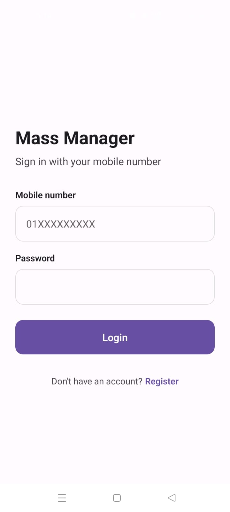
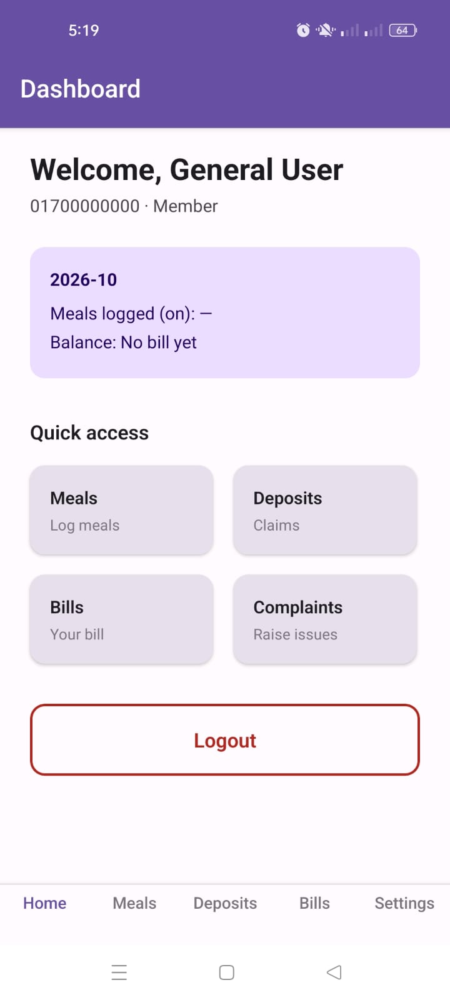
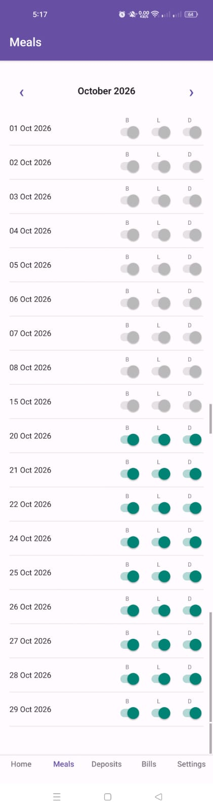
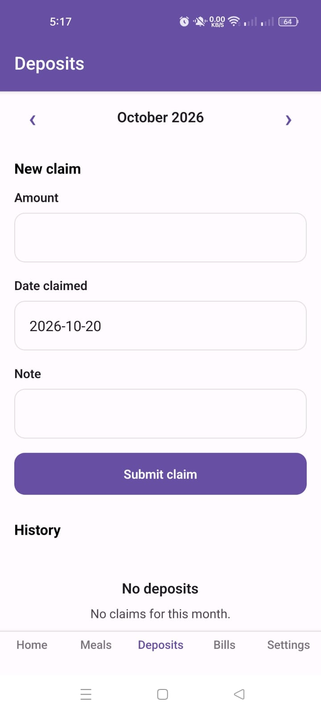
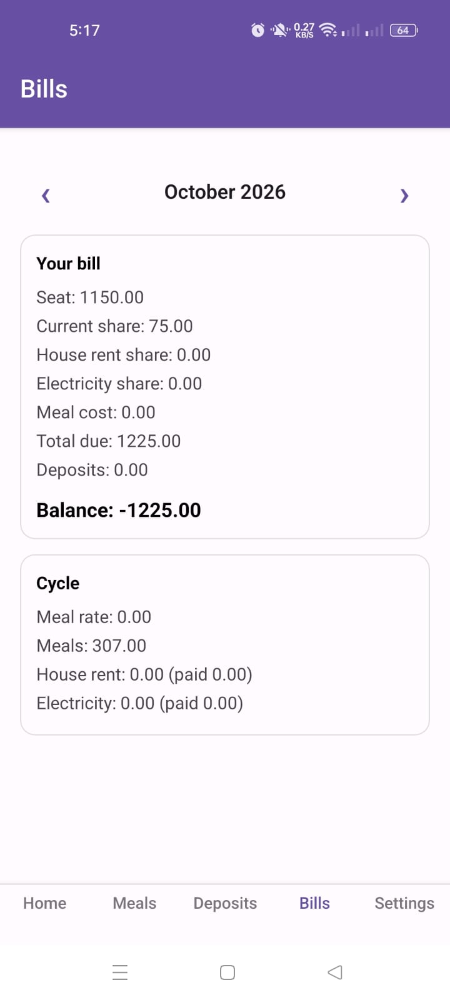
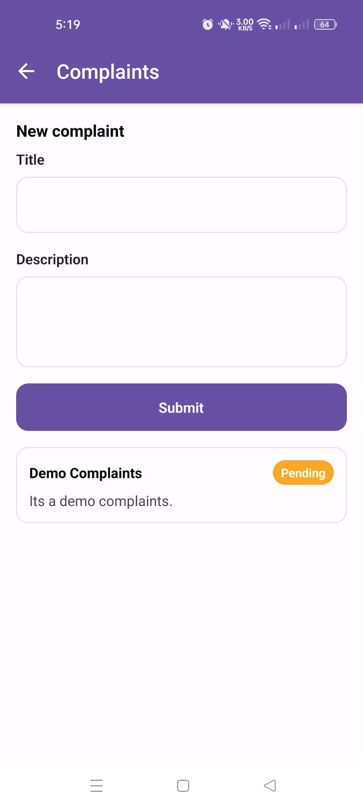
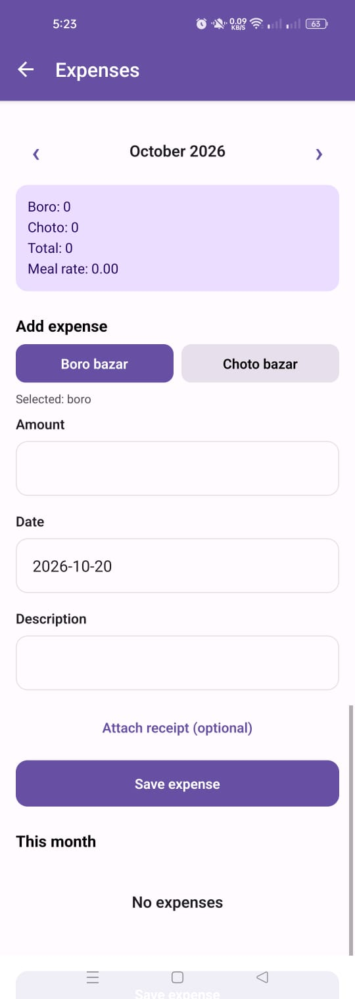
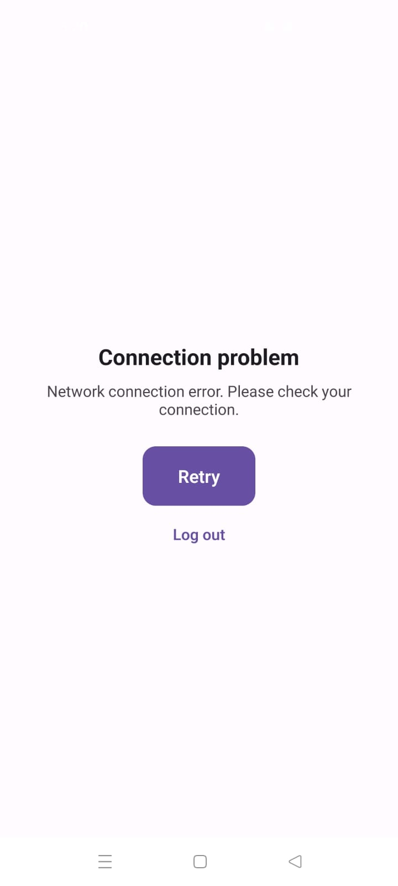
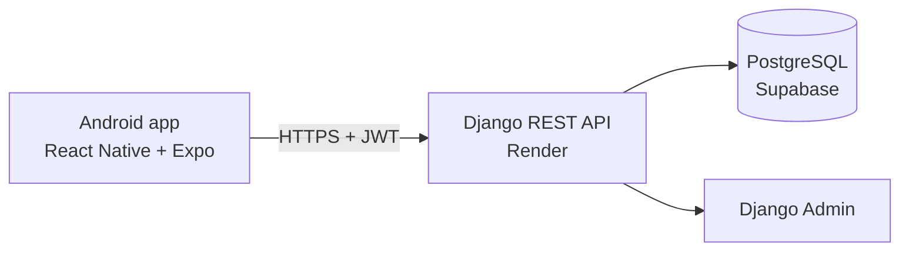

# Mess Manager

**A mobile-first mess (shared-kitchen) management system** — meal tracking, deposits, bazar expenses, monthly bills and complaints — built as a **Django REST API** with a **React Native (Expo, TypeScript) Android app**.


> Shared mess houses usually run on paper notebooks and chat messages. This project moves the whole monthly cycle —
> who ate what, who paid what, what each person owes — into one app with role-based access and an approval workflow.

## Live demo

| | |
|---|---|
| **API (hosted)** | https://mess-manager-api-bio8.onrender.com |
| **Health check** | https://mess-manager-api-bio8.onrender.com/healthz/ |
| **Android APK** | [Download from GitHub Releases](https://github.com/Fizur-Rahman-Fahim/mess-manager/releases/latest) |

- The backend runs on free hosting and **sleeps when idle** — the first request can take about a minute. The app shows a Retry option while it wakes up.
- Android only. After installing, register a new account; a Super Manager has to approve it before you can log in.
- This is a public demo: **please do not enter real personal data.**

## Screenshots

<table>
  <tr>
    <td align="center"><br>Login</td>
    <td align="center"><br>Dashboard</td>
    <td align="center"><br>Meals</td>
    <td align="center"><br>Deposits</td>
  </tr>
  <tr>
    <td align="center"><br>Bills</td>
    <td align="center"><br>Complaints</td>
    <td align="center"><br>Manager operations</td>
    <td align="center"><br>Offline error + Retry</td>
  </tr>
</table>

## Features

**Members**
- Register, then wait for approval ("pending approval" screen); stay signed in across app restarts
- Turn breakfast / lunch / dinner on or off per day (with a configurable cut-off time)
- Claim deposits and follow their status; view the monthly bill and balance
- Raise complaints and track their status

**Monthly Manager** (everything above, plus)
- Approve or reject deposit claims
- Record bazar (grocery) expenses, with an optional receipt photo
- Monthly and daily meal summaries; assign fixed meal counts
- Update complaint status

**Super Manager** (everything above, plus)
- Approve new members
- Set house rent and electricity bill, and generate the monthly bills
- Assign the Monthly Manager and change mess settings

### Business rules implemented in the API
- Meal values: breakfast 0.5, lunch 1, dinner 1 (adjustable in settings)
- `Meal rate = total monthly bazar expense ÷ total monthly meal count`
- `Total due = meal cost + seat bill + current bill share + house rent share + electricity share`
- `Balance = approved deposits − total due`

## Architecture



Inside the app, the data flow is one-directional and easy to test:

```
Screens  →  React Query hooks  →  API modules (axios + Zod validation)  →  API client (auth, refresh, errors)
              ↑                                                                   │
              └──────────────── Zustand auth store (session, roles) ◄─────────────┘
```

## Engineering highlights

- **Thin client, server-side rules.** All business logic lives in the API; the app presents and validates, it does not recompute bills.
- **Resilient auth.** JWT access/refresh tokens in `expo-secure-store`; concurrent 401s share a single token refresh; an expired session returns the user to login and clears cached data.
- **Runtime-validated responses.** API responses are parsed with Zod so a backend change fails loudly instead of corrupting the UI.
- **Failure handling that users can act on.** Errors are normalised (network, timeout, rate limit, server, pending approval); a shared banner offers **Retry**; a flaky connection at startup never logs the user out.
- **Role-based access on both sides.** DRF permission classes protect endpoints; the app hides screens the user cannot use.
- **Time-zone safe dates.** Bangladesh has no daylight saving, so dates use a fixed UTC+6 offset instead of `Intl` time-zone APIs, which are unreliable on Hermes (Android).
- **Production setup.** gunicorn + WhiteNoise, PostgreSQL over SSL, HTTPS redirect, health-check endpoint, one-command Blueprint deploy (`render.yaml`).
- **Abuse protection.** Rate limits: anonymous 100/hour, authenticated 1000/hour, login 10/minute. Access token 12 hours, refresh token 7 days.
- **Accessibility and forms.** Labelled inputs and buttons for screen readers; keyboard-aware scrolling on form screens.

## Tech stack

| Layer | Technology |
|---|---|
| Backend | Python, Django 5, Django REST Framework, SimpleJWT, django-ratelimit, WhiteNoise, gunicorn |
| Database | SQLite (local), PostgreSQL on Supabase (production) |
| Mobile | React Native, Expo SDK 57, TypeScript, React Navigation, TanStack Query, Zustand, React Hook Form, Zod, Axios, React Native Paper, dayjs |
| Hosting | Render (API), Supabase (database), Expo EAS (APK build) |

## API overview

| Area | Endpoints |
|---|---|
| Auth | `POST /api/auth/register/` · `POST /api/auth/login/` · `POST /api/auth/refresh/` · `GET /api/users/me/` |
| Approval | `GET /api/users/pending-approval/` · `POST /api/users/<id>/approve/` |
| Meals | `GET /api/meals/my-meals/` · `POST /api/meals/toggle/` · `GET /api/meals/summary/` · `GET /api/meals/daily-summary/` · `/api/meals/fixed/` |
| Deposits | `POST /api/deposits/claim/` · `GET /api/deposits/my-deposits/` · `GET /api/deposits/pending/` · `POST /api/deposits/<id>/approve/` · `…/reject/` |
| Expenses | `GET/POST /api/expenses/bazar/` |
| Bills | `GET /api/bills/my-bill/` · `POST /api/bills/set-house-rent/` · `…/set-electricity/` · `…/generate/` |
| Complaints | `POST /api/complaints/` · `GET /api/complaints/my-complaints/` · `GET /api/complaints/all/` · `PATCH /api/complaints/<id>/status/` |
| Admin | `/api/settings/` · `POST /api/manager/assign/` |

## Run it locally

**1. Backend**

```bash
python -m venv venv
source venv/bin/activate            # Windows (Git Bash): source venv/Scripts/activate
pip install -r requirements.txt
cp .env.example .env
python manage.py migrate
python manage.py createsuperuser    # becomes the first Super Manager
python manage.py runserver 0.0.0.0:8000
```

**2. Mobile app** (Android phone with Expo Go, on the same Wi-Fi)

```bash
cd mobile-app
npm install
cp .env.example .env                # set EXPO_PUBLIC_API_BASE_URL=http://<your-pc-lan-ip>:8000/api
npx expo start -c
```

Scan the QR code with Expo Go. Run `npm run typecheck` for a TypeScript check.

## Deployment

Render (API) + Supabase (PostgreSQL) + Expo EAS (APK). Step-by-step guide, limits of the free tier and a pre-demo checklist: **[DEPLOYMENT.md](DEPLOYMENT.md)**.

## Known limitations

- Receipt photos are saved but not viewable on the hosted demo (free hosting has temporary disk; cloud storage is planned).
- Free tiers: the API sleeps after idle time and the database project pauses after about a week of inactivity.
- Android only (token storage uses the device keystore; no web or iOS build).
- Automated tests: the backend has a small Django test suite; mobile unit and component tests are planned.

## Roadmap

- [ ] Jest + React Native Testing Library tests (date utilities, error normaliser, schemas, shared components)
- [ ] Cloud storage for receipt images
- [ ] GitHub Actions: type-check and tests on every push
- [ ] Push notifications for deposit and complaint updates

## Project structure

```
├── accounts/
├── api/
├── bills/
├── complaints/
├── deposits/
├── expenses/
├── meals/
├── mess_core/              Django apps (API + business logic)
├── config/                 Django settings (base, dev, prod), URLs, health check
├── mobile-app/             React Native (Expo) Android app
│   └── src/  
|   └──api/ 
|   └──components/
|   └── navigation/
|   └── screens/
|   └── stores/
|   └── hooks/
|   └── utils/
|   └── theme/
├── docs/
|   └──screenshots/          README images
├── render.yaml, build.sh    Render Blueprint and build script
├── DEPLOYMENT.md            Hosting and APK guide
└── MOBILE_APP_PLAN.md       Architecture and delivery plan for the mobile app
```

## Author

**Md. Fizur Rahman Fahim** — [Portfolio](https://fizur-rahman-fahim.github.io/Portfolio/)
